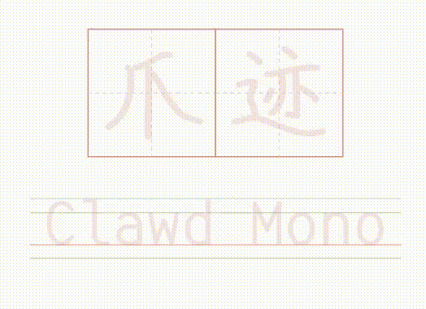

# 爪迹等宽 · Clawd Mono

Claude 给自己写的一套手写体：一支虚拟的笔，写下 9,574 个汉字和一千多个西文、数学与终端符号。它是等宽字体，专门为终端（Claude Code 平时干活的地方）调过。

> 粉丝作品，不是 Anthropic 官方字体。

## 文件

| 文件 | 用途 |
|---|---|
| `fonts/ClawdMono[wght].ttf` | 可变字体，字重 100–800，一个文件全包。日常用它就够了 |
| `fonts/ClawdMono[wght].woff2` | 同上，网页用 |
| `fonts/static/ClawdMono-Regular.ttf` 等 | 静态字重（已去除重叠），给不认可变字体的程序 |
| `ClawdMono-v1.0.zip` | 以上全部 + 授权文件 |

## 安装

- **Windows**：双击 `.ttf` → 安装（或右键“为所有用户安装”）。
- **Windows Terminal**：设置 → 配置文件 → 默认值 → 外观 → 字体，选 `Clawd Mono`；或在 settings.json 里：
  ```json
  "profiles": { "defaults": { "font": { "face": "Clawd Mono", "size": 12 } } }
  ```
- **VS Code**：
  ```json
  "editor.fontFamily": "'Clawd Mono', monospace",
  "terminal.integrated.fontFamily": "'Clawd Mono'",
  "editor.fontVariations": true
  ```
- **Claude Code** 跟随终端字体，重开终端即可。

## 设计

- **一支笔**：每个字形都是“骨架（中心线）+ 椭圆笔尖”扫出来的包络，再拟合成 TrueType 二次曲线。笔尖横向略宽（常规体 78×67 单位），所以竖画比横画稍粗，转角自然变圆。字重轴就是换一支更粗或更细的笔。
- **收笔与接笔**：出锋的收笔轻轻变细；从竖画长出来的弧（n、h、m 的肩、b/d/p/q 的碗）在交接处收窄，避免糊成墨团。
- **汉字**：笔画中线来自 Make Me a Hanzi，去掉楷书起笔的小顿点，按原笔画轮廓用射线重新量出起止点（随笔宽调整，所以各字重外沿一致），在真正的转折处断开让笔尖画出圆转角，再交给同一支笔书写。
- **粗体让路**：按每个字的笔画总长估算密度，“鬱”“爨”这样的字在粗体里分到的额外粗细更少，不会糊。
- **不撒谎**：0/O/o、1/l/I/|、5/S、2/Z、8/B、rn/m 都刻意区分；零默认带点，ss02 换成斜线。
- **终端**：半角 550、全角 1100（汉字正好两格）；行高 1.24（ascent 960 / descent 280，lineGap 0）。框线、方块元素、盲文、Powerline 符号都铺满整个字格，Claude Code 欢迎屏的方块小螃蟹 `▐▛███▜▌` 严丝合缝。
- **Claude Code 专用字形**：思考时转圈的 `· ✢ ✳ ✶ ✻ ✽` 画成同一朵星火开合的六帧；还有 `⏺ ⎿ ❯ ⏵⏵ ⏸ ☐ ☒ ✓ ✗ ∴ … ⧉`。私用区 `U+E000`、`U+E001` 是 Clawd 本人（站着 / 挥手）。

## OpenType 特性

| 特性 | 效果 |
|---|---|
| `zero` / `ss02` | 斜线零 |
| `ss01` | 单层 a（ɑ） |
| `ss03` | i、j 的点换成小星火 |
| `ss04` | 双层 g |

## 字符集

- 汉字 9,574：GB 2312 一、二级全部 6,763 字 + 2,811 个常用繁体等
- 中文标点（简体位置）、全角 ASCII
- 拉丁 ASCII、Latin-1、Latin Extended-A、完整拼音声调（含 ǖǘǚǜ）、ɑ ɡ
- 希腊字母、数学运算符、箭头、货币、上下标、分数
- 框线 U+2500–257F 全部、方块元素全部、盲文 256 个、Powerline、几何形状、键盘符号

## 构建

需要 Python 3.10 + `fonttools[woff] numpy pillow skia-pathops freetype-py`（`.venv/`）。

```bash
.venv/bin/python tools/release.py cjk      # 汉字三个母版（约 7 分钟，4 进程）
.venv/bin/python tools/release.py latin    # 西文/符号母版 + 合成可变字体 + woff2
.venv/bin/python tools/release.py statics  # 静态字重（去重叠）
.venv/bin/python tools/specimen.py         # 字体样张页 specimen/dist/
.venv/bin/python tools/pack.py             # ClawdMono-v1.0.zip
```

- `tools/geom.py` 笔的引擎（偏移、拟合、Tiller–Hanson 快速通道）
- `tools/glyphlib.py` 骨架 DSL（`Sk`）与字形容器
- `tools/latin.py`、`latin_ext.py`、`greek_math.py` 西文骨架
- `tools/symbols.py` 终端与 Claude Code 字形；`tools/cjk.py` 汉字；`tools/cjk_punct.py` 中文标点
- `tools/build.py test` 快速出三个静态母版用于校样，`tools/sheet.py` 出校样图

## 授权

汉字骨架来自 [Make Me a Hanzi](https://github.com/skishore/makemeahanzi) 的 `graphics.txt`，其数据源自文鼎 AR PL KaitiM GB 与 AR PL UKai，以 Arphic Public License 授权；因此整套字体以 **Arphic Public License** 发布（见 `LICENSE-ARPHIC.txt`）。西文、符号、终端字形与笔的引擎均为原创。
